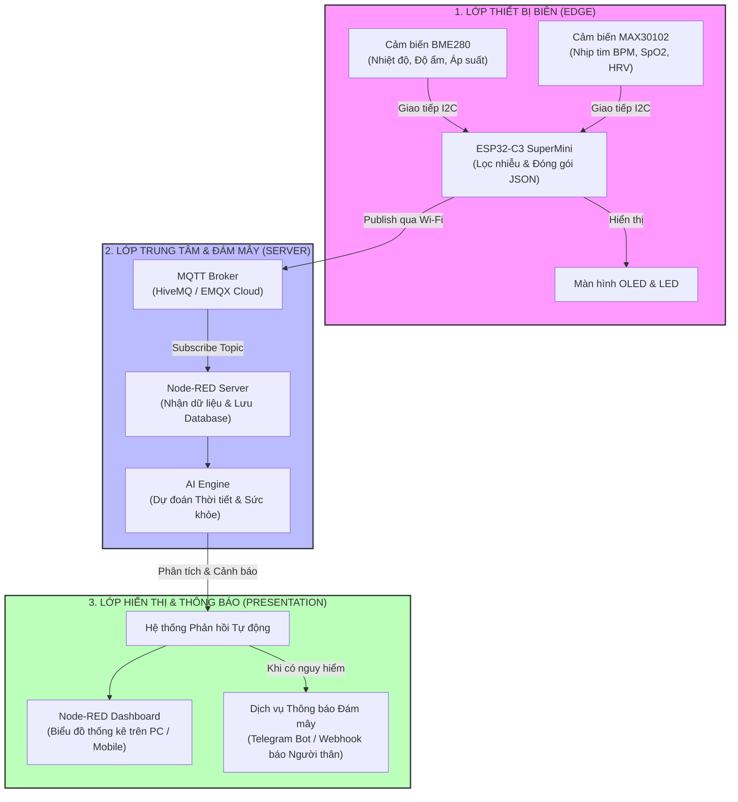
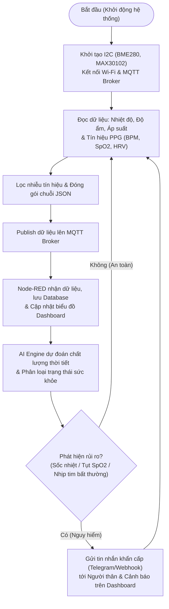

** THÔNG TIN ĐỀ TÀI**

  **TÊN ĐỀ TÀI:** Thiết bị đeo tay thông minh dự đoán biến đổi thời tiết và theo dõi sức khỏe người dùng

**Sinh Viên:** Hồ Đăng Dũng

**Giáo Viên Hướng Dẫn:** Nguyễn Tuấn Anh

**1. GIỚI THIÊU TỔNG QUAN VÀ ĐẶT VẤN ĐỀ**

Sự biến đổi thất thường của thời tiết va môi trường sống hiện nay tác động trực tiếp đến hệ tim mạch cũng như hô hấp của con người. Mặc dù nhu cầu tự theo dõi sức khỏe
và cập nhật thời tiết tại nhà càng cao, các thiết bị và ứng dụng phổ biến trên thị trường vẫn còn một số hạn chế :

* **Sai lệch giữa dự báo diện rộng và môi trường thực tế:** Thông tin từ các đài khí tượng chỉ mang tính khu vực chung, không đo lường được nhiệt độ, độ ẩm và áp suất
  thực tế trong không gian kín hoặc vị trí làm việc của người dùng.
* **Đánh giá sức khỏe thiếu ngữ cảnh môi trường:** Các thiết bị đo nhịp tim và SpO2 cá nhân chỉ đọc chỉ số cơ thể một cách độc lập. Việc tách rời thông số
  sinh học khỏi điều kiện nhiệt độ, độ ẩm xung quanh khiến người dùng không nhận biết được các hội chứng nguy hiểm như sốc nhiệt, mệt mỏi do tụt áp suất khí quyển.
* **Dự liệu phân mảnh, khó theo dõi:** Người dùng phải sử dụng nhiều thiết bị và ứng dụng rời rạc cho từng mục đích, thiếu một giao diện tập trung để thống kê và
  đối chiếu lịch sử sức khỏe cùng biến động thời tiết
* **Thiếu tính năng phân tích và dự báo thông minh:** Phần lớn thiết bị đo dân dụng chỉ hiển thị con số tức thời mà chưa có khả năng học máy để dự đoán xu hướng thời tiết
ngắn hạn hay cảnh báo sớm nguy cơ suy giảm sức khỏe.

Từ thực tế đó, dự án xây dựng một hệ thống IoT tích hợp giúp giám sát song song khí hậu và chỉ số sinh tồn của cơ thể trên cùng một nền tảng. Thiết bị phần cứng sử dụng
**ESP32-C3 mini** để thu thập dữ liệu nhiệt độ, độ ẩm, áp suất qua cảm biến **BME/BMP280** cùng nhịp tim, nồng độ oxy trong máu (SpO2) từ cảm biến **MAX30102**. Toàn
bộ thông số được đồng bộ thời gian thực được lưu trữ vào đám mây thông qua **MQTT** và dữ liệu sẽ được xử lí và được hiển qua giao diện.

**2. MỤC TIÊU CỦA ĐỀ TÀI**

**3. KIẾN TRÚC HỆ THỐNG VÀ SƠ ĐỒ KHỐI**

**3.1. Sơ đồ khối**

**3.2. Phần cứng**

| Linh kiện | Vai trò |
| :--- | :--- |
| **ESP32-C3 SuperMini** | Vi điều khiển trung tâm, kết nối Wi-Fi |
| **Module cảm biến BME280** | Đo nhiệt độ, độ ẩm tương đối và áp suất khí quyển (giám sát vi khí hậu cục bộ) |
| **Module cảm biến MAX30102** | Thu thập nhịp tim (**BPM**), **SpO₂** và đo biến thiên nhịp tim (**HRV**) |
| **Màn hình OLED 0.96" SSD1306 (I2C)** *(Tùy chọn)* | Hiển thị thông số thời tiết và sức khỏe trực tiếp tại chỗ |
| **Đèn LED báo trạng thái** | Chỉ thị trạng thái kết nối Wi-Fi và hoạt động của hệ thống |
| **Dịch vụ thông báo đám mây (Telegram Bot / Webhook)** | Gửi cảnh báo khẩn cấp qua Internet đến người thân khi thời tiết hoặc chỉ số sức khỏe nguy hiểm |
| **Nút bấm (Push Button)** | Thao tác nhanh / Gửi tín hiệu test thủ công |
| **Pin Li-ion + mạch sạc (TP4056)** | Cung cấp nguồn di động cho thiết bị hoạt động liên tục |

**3.3. Lưu đồ thuật toán**

**3.4. Hướng phát triển thêm**

Để nâng cấp thiết bị từ mô hình thử nghiệm thành một sản phẩm hoàn chỉnh có tính thương mại và ứng dụng thực tiễn cao hơn, dự án đề xuất các hướng mở rộng sau:

* **Tích hợp cảm biến gia tốc (MPU6050) để khử nhiễu chuyển động:** Bổ sung cảm biến chuyển động nhằm nhận diện trạng thái người dùng (đang nghỉ ngơi, đi bộ hay chạy bộ). Điều này giúp thuật toán lọc bỏ nhiễu tín hiệu quang học (Motion Artifacts) trên **MAX30102** và giúp mô hình AI không báo động giả khi nhịp tim tăng tự nhiên lúc tập thể dục.
* **Triển khai AI tại biên (TinyML / Edge AI):** Chuyển đổi mô hình học máy sang định dạng **TensorFlow Lite for Microcontrollers** hoặc xuất trực tiếp ra mã C/C++ nhúng thẳng vào **ESP32-C3 SuperMini**. Thiết bị sẽ có khả năng tự phân tích và phát cảnh báo tức thời ngay cả khi mất kết nối mạng Wi-Fi hoặc đứt kết nối tới **MQTT Broker**.
* **Mở rộng đo chất lượng không khí trong nhà (IAQ):** Nâng cấp hoặc kết hợp thêm các cảm biến đo bụi mịn (**PM2.5**) và nồng độ khí $\text{CO}_2$, **VOCs** (như **BME680** hoặc **SGP30**) bên cạnh **BME280**, giúp đánh giá toàn diện tác động của ô nhiễm không khí đến hệ hô hấp và chỉ số $\text{SpO}_2$.
* **Tối ưu hóa năng lượng và thiết kế phần cứng đeo tay:** Thiết kế mạch in (**PCB**) thu gọn kích thước và in 3D vỏ hộp dạng vòng đeo tay hoặc thiết bị kẹp ngón tay di động; kết hợp chế độ ngủ sâu (**Deep Sleep**) trên ESP32-C3 để kéo dài thời lượng sử dụng pin Li-ion lên nhiều ngày.
* **Xây dựng ứng dụng di động độc lập và cá nhân hóa AI:** Phát triển ứng dụng di động riêng (bằng **Flutter** hoặc **React Native**) thay thế dần giao diện web của **Node-RED Dashboard**, đồng thời cho phép mô hình AI tự học hỏi (Fine-tuning) theo dữ liệu lịch sử riêng biệt của từng độ tuổi và bệnh lý nền của người dùng.
